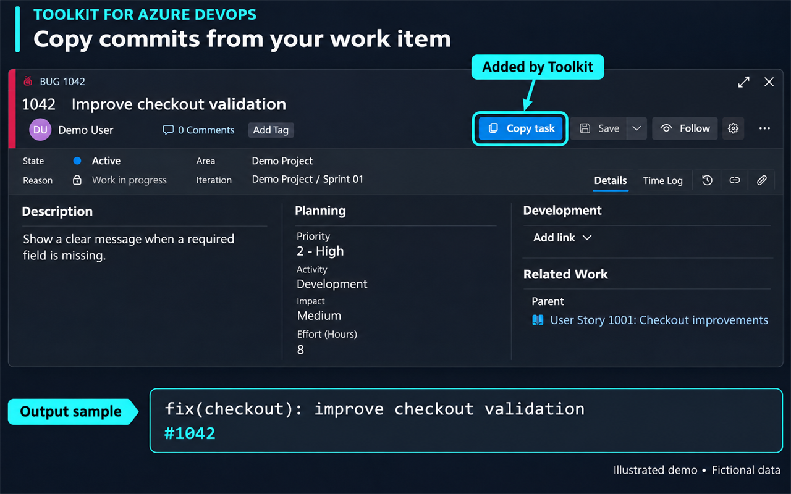
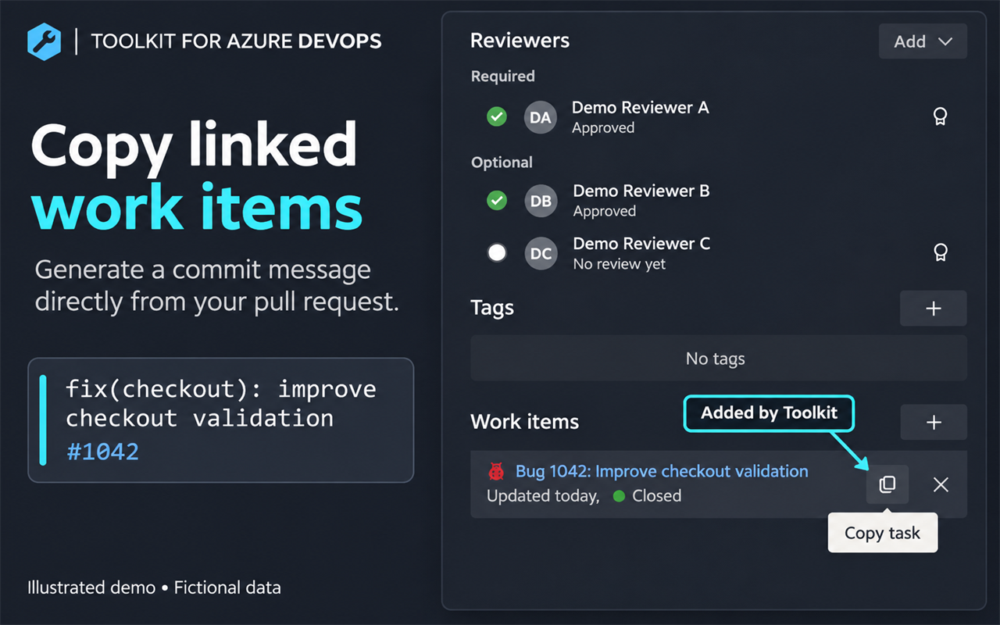
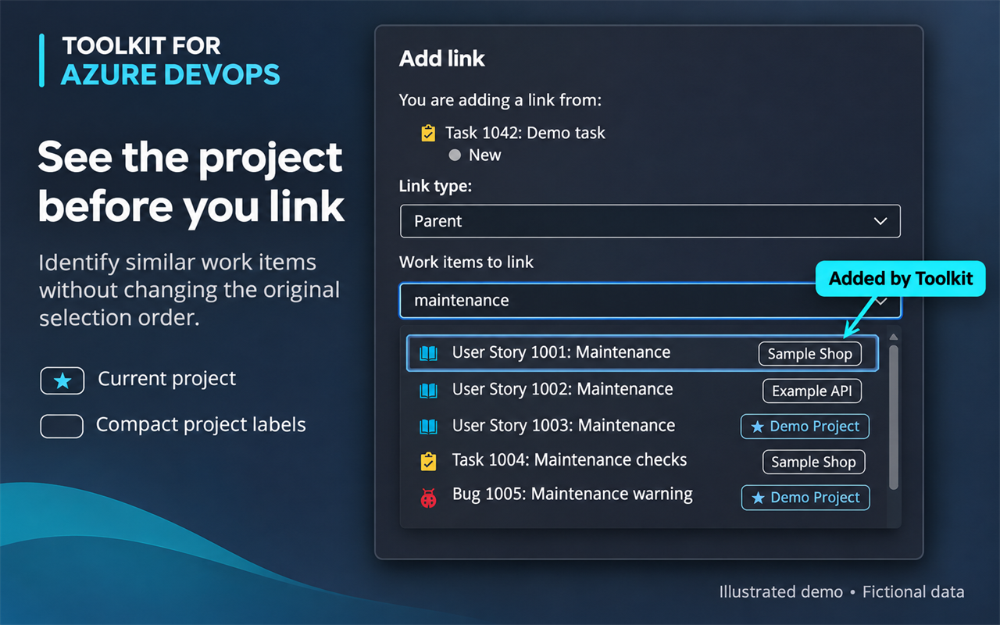

# Toolkit for Azure DevOps

Extensão Manifest V3 para Microsoft Edge e Google Chrome com módulos de produtividade para Azure DevOps: cópia de commits e identificação de projetos na seleção de vínculos.

Versão atual: **1.2.3** · [Histórico de versões](CHANGELOG.md) · [Política de privacidade](PRIVACY.md) · [Suporte](https://github.com/Picolii/Toolkit-for-Azure-DevOps/issues)

## Instalar pela loja

[Microsoft Edge Add-ons](https://microsoftedge.microsoft.com/addons/detail/mafhbkcjbojkfpphmompopghepifbmlg)

A versão publicada pode estar atrás do pacote deste repositório enquanto uma atualização aguarda revisão. Consulte o histórico do Git e as tags para identificar o código de cada pacote.

## Baixar o pacote atual

[toolkit-for-azure-devops-1.2.3.zip](dist/toolkit-for-azure-devops-1.2.3.zip)

Para instalar localmente, extraia o ZIP e selecione a pasta com `manifest.json`. Não selecione o arquivo ZIP na opção Carregar sem compactação. O mesmo ZIP é o pacote enviado ao Partner Center.

## Idiomas

A interface acompanha o idioma do navegador: português (Brasil/Portugal), inglês, espanhol, francês, italiano, alemão, japonês, coreano e chinês simplificado. Outros idiomas usam inglês. Botões, painel, tooltips e mensagens são traduzidos; títulos, tags, nomes de projetos e formato dos commits permanecem inalterados. Detalhes de erros fornecidos pelo Azure permanecem no idioma do serviço.

No painel, o seletor **Idioma** vem em **Automático — idioma do navegador**. Você pode escolher outro idioma; a preferência é salva localmente e o painel muda imediatamente. Atualize a página do Azure para aplicar aos botões e tooltips dos módulos. Volte a Automático para acompanhar novamente o navegador. O nome da extensão na loja e no gerenciador continua usando o mecanismo nativo de idioma do navegador.

Traduções locais em `_locales/`, sem serviço externo. Edite `scripts/build-locales.js` e execute `node scripts/build-locales.js` para atualizar os catálogos e o fallback.

## Recursos

- **Copiar task no Work Item:** gera uma mensagem de commit a partir do título, tipo, tags e número do item.
- **Copiar Work Item no Pull Request:** adiciona um botão de cópia aos itens vinculados a um PR.
- **Projetos nos vínculos:** mostra o projeto dos resultados em Add link e destaca o projeto atual, preservando ordem, cliques e navegação por teclado.

Os projetos são consultados em lote pela API da organização, com cache limitado à memória da aba. Resultados sem acesso continuam selecionáveis, sem etiqueta. A compatibilidade depende da estrutura dos diálogos e opções do Azure.

Os módulos são carregados automaticamente em `https://dev.azure.com/*` e `https://*.visualstudio.com/*`. Clique no ícone para ativar ou desativar cada módulo. Preferências são salvas localmente; salve as edições no Azure e atualize a página para aplicar. Os três módulos vêm ativados por padrão.

## Instalar no Microsoft Edge

1. Abra `edge://extensions`.
2. Ative o **Modo do desenvolvedor**.
3. Clique em **Carregar sem compactação**.
4. Selecione a pasta raiz deste repositório, a mesma que contém `manifest.json`.
5. Abra ou atualize uma página do Azure DevOps.

## Instalar no Google Chrome

1. Abra `chrome://extensions`.
2. Ative o **Modo do desenvolvedor**.
3. Clique em **Carregar sem compactação**.
4. Selecione a pasta raiz deste repositório.

## Atualizar durante o desenvolvimento

Depois de alterar algum arquivo, abra a página de extensões, clique em **Recarregar** no cartão da extensão e atualize a página do Azure DevOps.

Não é necessário remover e instalar novamente. Para um ZIP local, extraia a nova versão na **mesma pasta** carregada no navegador, substitua os arquivos e clique em Recarregar.

Na versão da loja, publique uma versão maior pelo Partner Center e aguarde aprovação: o navegador distribui a atualização automaticamente. O painel mostra a versão instalada e permite solicitar uma verificação manual, sujeita aos limites do navegador. Esse botão não atualiza os arquivos de uma pasta local.

## Arquivos

```text
Toolkit-for-Azure-DevOps/
├── manifest.json
├── I18n.js
├── ModuleSettings.js
├── CopyTask.js
├── PR_WorkItem_CopyTask.js
├── RelatedWorkProjects.js
├── popup.html / popup.css / popup.js
├── _locales/
├── icons/
├── scripts/
├── tests/
├── dist/
├── store-assets/
├── PRIVACY.md
├── CHANGELOG.md
└── README.md
```

## Capturas de tela

### Copiar task no Work Item



### Copiar item vinculado à PR



### Projetos na seleção de vínculos



As imagens são mockups ilustrativos com dados fictícios, baseados no layout do Azure. Os três PNGs têm 1280×800 e são enviados separadamente em Store listings → Edit details → Screenshots. [Pacote das imagens](store-assets/store-screenshots-v2.zip) · [Logo da loja](store-assets/logo-300.png). O script `store-assets/render-demos.ps1` gera somente a primeira versão das ilustrações, não as imagens v2 acima.

## Validação

Requer Node.js. Execute:

```sh
node tests/i18n.test.js
node tests/modules.test.js
node tests/related-work-projects.test.js
node tests/copy-task-duplicate.test.js
```

Os testes verificam catálogos e fallback de idioma, preferências dos módulos, etiquetas/cache e duplicação. Não substituem testes no DOM real do Azure, que pode mudar.

## Privacidade e independência

Consultas de work items e projetos são feitas na organização do Azure já aberta. O desenvolvedor não recebe esses dados; somente preferências de módulos/idioma são persistidas no dispositivo. O cache de projetos fica limitado à memória da aba.

Esta extensão é independente e não é afiliada nem endossada pela Microsoft. `Release_Checklist.js` é um script legado: não é carregado pelo manifesto nem distribuído no pacote atual.
